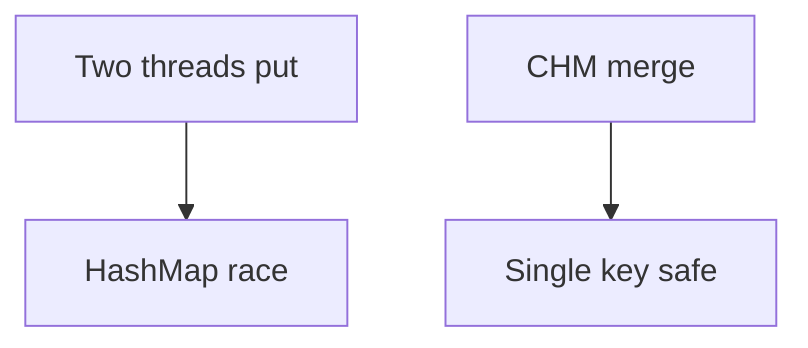

# Companion 4 — HashMap thread safety

**Canonical source:** [Mastery lesson](../../../01-engineering-mastery/core-java/module-03-hashmap-internals/04-thread-safety-and-concurrent-patterns.md).

**Cheat sheet:** [Module visual quick reference](module-visual-quick-reference.md).

## Definition

HashMap is not safe for concurrent structural updates; ConcurrentHashMap provides single-key atomic operations.

## Must remember

- Concurrent put can corrupt or lose updates.
- merge for counters.
- CHM is not a multi-key transaction.
- LongAdder for hot counters.

## Interview traps

- Synchronizing only the get.

## Interview flow

## Scenario bite

Two requests increment an order status count with get/put — lost update. Use merge.

## Decision table

| Situation | Prefer |
| --- | --- |
| Local map | HashMap |
| Shared counters | CHM or LongAdder |

## Explain aloud (whiteboard)

1. Name the race.
2. Name merge.
3. Multi-key still needs a transaction.

## 30-second revision

- Do not share HashMap mutably; use CHM atomic single-key ops.

## Memory hook

- **CHM** — Concurrent, one key, merge.

## Cross-links

- [Module visual quick reference](module-visual-quick-reference.md)
