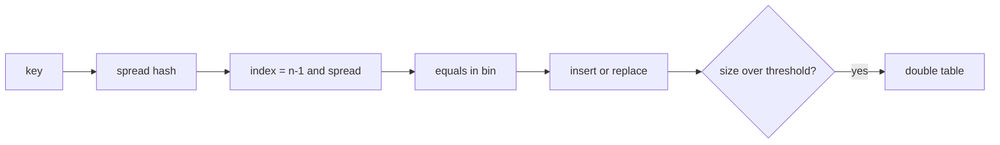

# HashMap — Visual Quick Reference

| Fact | Recall |
| --- | --- |
| Threshold | capacity × load factor (0.75) |
| Treeify | long chain **and** table large enough |
| Same key put | replace value, size unchanged |
| Threads | HashMap unsafe; CHM single-key atomic |

- [01 indexing](01-internal-table-and-hash-indexing.md)
- [02 put get treeify](02-put-get-flow-and-treeify.md)
- [03 resize](03-resize-load-factor-and-threshold.md)
- [04 concurrency](04-thread-safety-and-concurrent-patterns.md)
