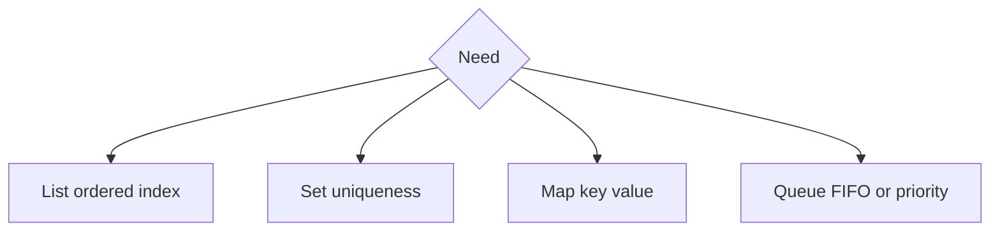

# Companion 1 — Collections framework

**Canonical source:** [Mastery lesson](../../../01-engineering-mastery/core-java/module-04-collections/01-collections-framework-overview.md).

**Cheat sheet:** [Module visual quick reference](module-visual-quick-reference.md).

## Definition

The Collections Framework is interfaces (Collection, List, Set, Queue, Map) plus implementations with different complexity and ordering.

## Must remember

- Program to interfaces.
- Map does not extend Collection.
- Choose by access pattern and thread-safety.
- Fail-fast iterators detect structural modification.

## Interview traps

- Interface Big-O equals every implementation — read the class javadoc.

## Interview flow

## Scenario bite

Payroll groups employees by department: Map, not a List scan, when lookup by key dominates.

## Decision table

| Situation | Prefer |
| --- | --- |
| Random access | ArrayList |
| Unique keys | Set or Map |
| FIFO tasks | Queue |

## Explain aloud (whiteboard)

1. Name the interface first.
2. Then the implementation.
3. State one complexity.

## 30-second revision

- Interfaces first; Map is separate; pick implementation by access.

## Memory hook

- **LSMQ** — List, Set, Map, Queue.

## Cross-links

- [Module visual quick reference](module-visual-quick-reference.md)
