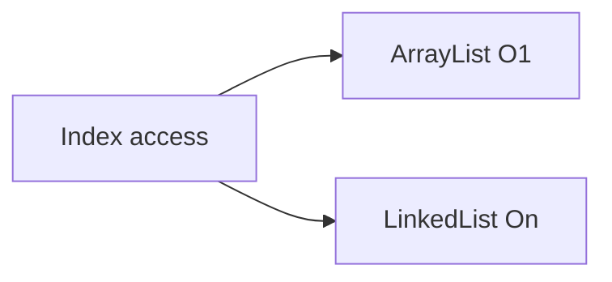

# Companion 2 — ArrayList vs LinkedList

**Canonical source:** [Mastery lesson](../../../01-engineering-mastery/core-java/module-04-collections/02-arraylist-vs-linkedlist.md).

**Cheat sheet:** [Module visual quick reference](module-visual-quick-reference.md).

## Definition

ArrayList is a growable array; LinkedList is a doubly linked list — random access and cache behavior differ sharply.

## Must remember

- ArrayList get(i) is O(1); LinkedList get(i) is O(n).
- Append amortized O(1) on ArrayList; occasional O(n) resize.
- LinkedList add/remove at a known node is O(1); finding the index is O(n).
- Prefer ArrayDeque over LinkedList for queues.

## Interview traps

- LinkedList is always faster for insert — index search dominates.
- ArrayList append is always O(1) — resize is O(n) occasionally.

## Interview flow

## Scenario bite

Order history UI pages by index — ArrayList. A queue of pending payments — ArrayDeque, not LinkedList.

## Decision table

| Situation | Prefer |
| --- | --- |
| Index-heavy | ArrayList |
| True deque | ArrayDeque |
| Frequent mid-list edits by iterator | Rare; still measure |

## Explain aloud (whiteboard)

1. Contrast get(i).
2. Mention resize amortization.
3. Reject LinkedList as default queue.

## 30-second revision

- ArrayList for index; avoid LinkedList unless you hold the node.

## Memory hook

- **AL** — Array for index, Link for node.

## Cross-links

- [Module visual quick reference](module-visual-quick-reference.md)
