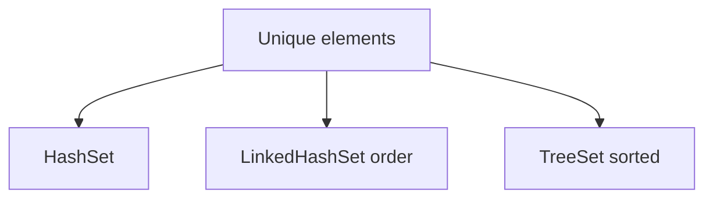

# Companion 3 — Set implementations

**Canonical source:** [Mastery lesson](../../../01-engineering-mastery/core-java/module-04-collections/03-set-implementations.md).

**Cheat sheet:** [Module visual quick reference](module-visual-quick-reference.md).

## Definition

Set forbids duplicates by equals; HashSet, LinkedHashSet, and TreeSet differ in order and cost.

## Must remember

- HashSet: average O(1), no order.
- LinkedHashSet: insertion order.
- TreeSet: sorted, O(log n), needs Comparable or Comparator.
- Mutable elements that change hashCode corrupt the set.

## Interview traps

- TreeSet without a total order throws or mis-orders.

## Interview flow

## Scenario bite

Dedupe SKUs in an order import: HashSet. Audit trail of first-seen SKUs: LinkedHashSet.

## Decision table

| Situation | Prefer |
| --- | --- |
| No order needed | HashSet |
| Insertion order | LinkedHashSet |
| Sorted range | TreeSet |

## Explain aloud (whiteboard)

1. Uniqueness via equals/hashCode.
2. Name ordering.
3. Warn on mutable keys.

## 30-second revision

- Hash unordered, linked insertion, tree sorted.

## Memory hook

- **HLT** — Hash, Linked, Tree.

## Cross-links

- [Module visual quick reference](module-visual-quick-reference.md)
