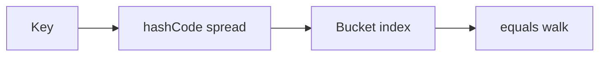

# Companion 4 — Map and HashMap

**Canonical source:** [Mastery lesson](../../../01-engineering-mastery/core-java/module-04-collections/04-map-fundamentals-and-hashmap.md).

**Cheat sheet:** [Module visual quick reference](module-visual-quick-reference.md).

## Definition

Map stores key-value pairs; HashMap uses hashing for average O(1) get/put and allows one null key.

## Must remember

- equals and hashCode contract on keys.
- Load factor and resize.
- Not thread-safe.
- null key allowed; ConcurrentHashMap forbids nulls.

## Interview traps

- Using a mutable key after put.
- Assuming HashMap iteration order.

## Interview flow

## Scenario bite

Lookup Employee by id in a request-scoped cache: HashMap if single-threaded; ConcurrentHashMap if shared.

## Decision table

| Situation | Prefer |
| --- | --- |
| Single thread cache | HashMap |
| Shared counters | ConcurrentHashMap |
| Sorted keys | TreeMap |

## Explain aloud (whiteboard)

1. Hash then equals.
2. Null key policy.
3. Not safe for concurrent writers.

## 30-second revision

- HashMap is hashed buckets; contract on keys; not concurrent.

## Memory hook

- **HEB** — Hash, Equals, Bucket.

## Cross-links

- [Module visual quick reference](module-visual-quick-reference.md)
