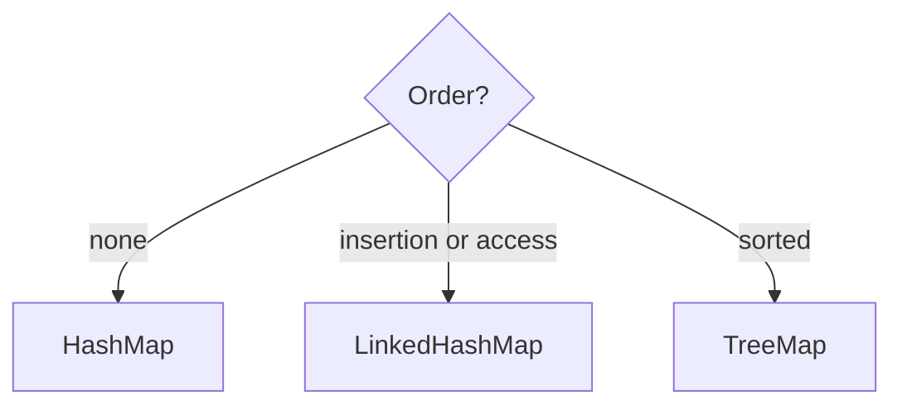

# Companion 5 — HashMap, LinkedHashMap, TreeMap

**Canonical source:** [Mastery lesson](../../../01-engineering-mastery/core-java/module-04-collections/05-hashmap-linkedhashmap-treemap.md).

**Cheat sheet:** [Module visual quick reference](module-visual-quick-reference.md).

## Definition

These maps trade order and cost: hash speed, insertion/access order, or sorted keys.

## Must remember

- LinkedHashMap accessOrder=true enables LRU.
- TreeMap navigable ranges.
- HashMap fastest average lookups.
- TreeMap forbids null keys.

## Interview traps

- Expecting HashMap to stay sorted.

## Interview flow

## Scenario bite

LRU of recent Order ids: LinkedHashMap with access order and removeEldestEntry.

## Decision table

| Situation | Prefer |
| --- | --- |
| Plain cache | HashMap |
| LRU | LinkedHashMap |
| Range query on keys | TreeMap |

## Explain aloud (whiteboard)

1. State the order guarantee.
2. LRU flag.
3. log n vs amortized O(1).

## 30-second revision

- Hash speed, linked order, tree sort.

## Memory hook

- **HLT maps**.

## Cross-links

- [Module visual quick reference](module-visual-quick-reference.md)
