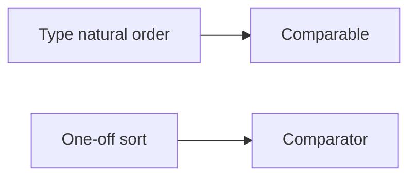

# Companion 6 — Comparable and Comparator

**Canonical source:** [Mastery lesson](../../../01-engineering-mastery/core-java/module-04-collections/06-comparable-and-comparator.md).

**Cheat sheet:** [Module visual quick reference](module-visual-quick-reference.md).

## Definition

Comparable is the type's natural order; Comparator is an external order for a specific collection or sort.

## Must remember

- TreeSet/TreeMap need a consistent order with equals for Set semantics.
- Comparator.comparing for streams and sorts.
- Inconsistent compareTo vs equals breaks SortedSet.
- Multiple comparators for different UI sorts.
- `reversed()` after `thenComparing()` reverses the whole composed comparator.

## Interview traps

- compareTo returning 0 for unequal objects in a TreeSet drops entries.

## Interview flow

## Scenario bite

Sort payments by amount for a report without changing Payment's natural id order — use Comparator.

## Decision table

| Situation | Prefer |
| --- | --- |
| Natural order in TreeSet | Comparable |
| Report sort | Comparator |
| Both | Keep equals aligned with compareTo if used as set |

## Explain aloud (whiteboard)

1. Natural vs external.
2. Consistency with equals.
3. Example: amount vs id.

## 30-second revision

- Comparable lives on the type; Comparator is external.

## Memory hook

- **NC** — Natural Comparable, Custom Comparator.

## Cross-links

- [Module visual quick reference](module-visual-quick-reference.md)
