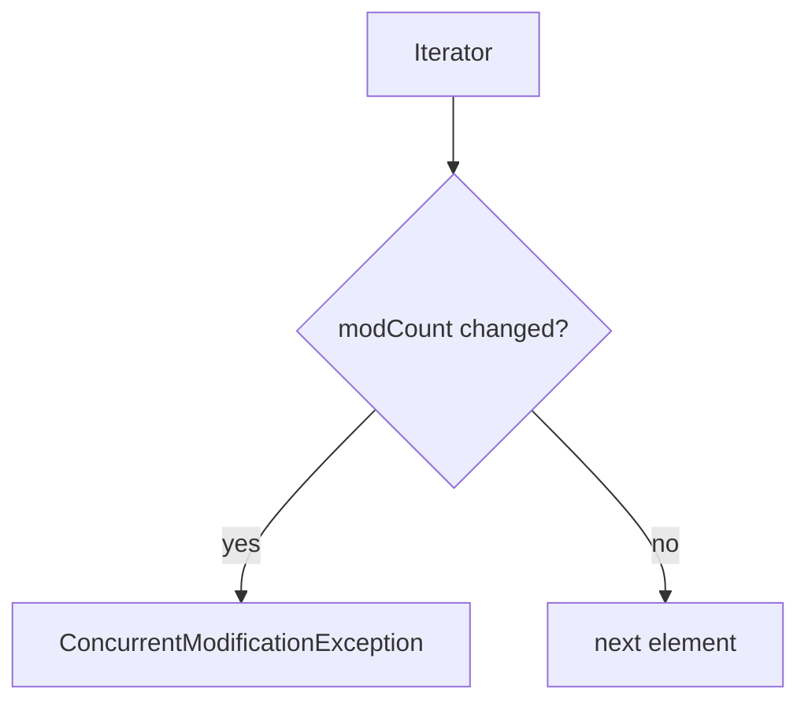

# Companion 7 — Iterators and modification

**Canonical source:** [Mastery lesson](../../../01-engineering-mastery/core-java/module-04-collections/07-iterators-and-modification.md).

**Cheat sheet:** [Module visual quick reference](module-visual-quick-reference.md).

## Definition

Fail-fast iterators track structural modification and throw ConcurrentModificationException if the collection changes during iteration except via the iterator.

## Must remember

- modCount increments on structural change.
- iterator.remove() is safe.
- Fail-fast is best-effort, not a concurrency guarantee.
- Concurrent collections use weakly consistent iterators.

## Interview traps

- CME means the map is thread-safe — it does not.

## Interview flow

## Scenario bite

Removing unpaid orders while looping a list: use iterator.remove or removeIf, not list.remove inside for-each.

## Decision table

| Situation | Prefer |
| --- | --- |
| Single thread filter | removeIf |
| Need iterator | iterator.remove |
| Concurrent map | CHM, no CME contract |

## Explain aloud (whiteboard)

1. modCount idea.
2. Safe removal API.
3. CME is not a lock.

## 30-second revision

- Don't structurally modify during fail-fast iteration except via the iterator.

## Memory hook

- **MOD** — Modify only via iterator or removeIf.

## Cross-links

- [Module visual quick reference](module-visual-quick-reference.md)
