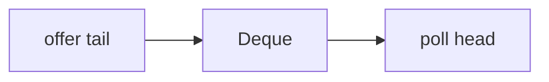

# Companion 8 — Queue and Deque

**Canonical source:** [Mastery lesson](../../../01-engineering-mastery/core-java/module-04-collections/08-queue-and-deque.md).

**Cheat sheet:** [Module visual quick reference](module-visual-quick-reference.md).

## Definition

Queue is FIFO (or priority); Deque supports both ends. ArrayDeque is the usual non-thread-safe deque.

## Must remember

- Offer/poll vs add/remove exception policy.
- ArrayDeque no nulls, faster than LinkedList.
- Do not use Stack class; use Deque.
- PriorityQueue is not FIFO.

## Interview traps

- LinkedList as the default queue.

## Interview flow

## Scenario bite

Undo stack of order edits: ArrayDeque as stack (push/pop).

## Decision table

| Situation | Prefer |
| --- | --- |
| FIFO in one thread | ArrayDeque |
| Blocking producers | BlockingQueue |
| Priority | PriorityQueue |

## Explain aloud (whiteboard)

1. Ends of a deque.
2. ArrayDeque over LinkedList.
3. Exception vs null poll.

## 30-second revision

- ArrayDeque for stack and queue in one thread.

## Memory hook

- **DEQ** — Double-ended queue.

## Cross-links

- [Module visual quick reference](module-visual-quick-reference.md)
