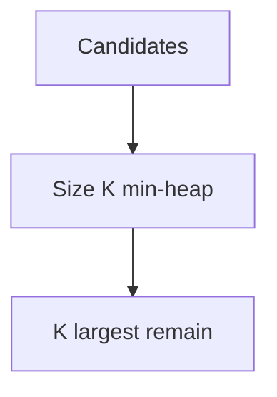

# Companion 9 — PriorityQueue and heaps

**Canonical source:** [Mastery lesson](../../../01-engineering-mastery/core-java/module-04-collections/09-priorityqueue-and-heaps.md).

**Cheat sheet:** [Module visual quick reference](module-visual-quick-reference.md).

## Definition

PriorityQueue is a binary heap: peek/poll the extreme by comparator, not sorted iteration.

## Must remember

- Offer/poll O(log n).
- No stable full sort until you drain.
- Top-K largest uses a size-K min-heap.
- Not thread-safe.

## Interview traps

- Iterating a heap yields sorted order — it does not.

## Interview flow

## Scenario bite

Top 10 orders by amount in a stream: min-heap of size 10, evict smaller roots.

## Decision table

| Situation | Prefer |
| --- | --- |
| Top-K | Bounded heap |
| Full sort | List sort or TreeSet |
| Thread-safe priority | PriorityBlockingQueue |

## Explain aloud (whiteboard)

1. Heap property.
2. Top-K min-heap trick.
3. Iteration is not sorted.

## 30-second revision

- Heap gives the extreme fast; bound the size for Top-K.

## Memory hook

- **TOPK** — Tiny min-heap keeps the biggest K.

## Cross-links

- [Module visual quick reference](module-visual-quick-reference.md)
