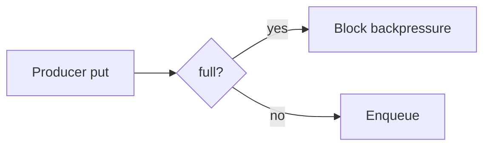

# Companion 10 — Blocking queues and backpressure

**Canonical source:** [Mastery lesson](../../../01-engineering-mastery/core-java/module-04-collections/10-blocking-queues-and-backpressure.md).

**Cheat sheet:** [Module visual quick reference](module-visual-quick-reference.md).

## Definition

BlockingQueue blocks producers when full and consumers when empty — capacity is backpressure.

## Must remember

- put/take vs offer/poll with timeout.
- ArrayBlockingQueue is bounded.
- Unbounded queue hides overload.
- Capacity is not consumer parallelism.

## Interview traps

- Unbounded LinkedBlockingQueue under spike — latency explodes.

## Interview flow

## Scenario bite

Payment webhook workers: bounded ArrayBlockingQueue plus a fixed pool; reject or caller-runs when saturated.

## Decision table

| Situation | Prefer |
| --- | --- |
| Need bound | ArrayBlockingQueue |
| Handoff | SynchronousQueue |
| Priority plus block | PriorityBlockingQueue |

## Explain aloud (whiteboard)

1. Full queue blocks producer.
2. Separate consumer count.
3. Timeouts for shutdown.

## 30-second revision

- Bounded blocking queue is in-process backpressure.

## Memory hook

- **PUT** — Producers unblock when consumers take.

## Cross-links

- [Module visual quick reference](module-visual-quick-reference.md)
