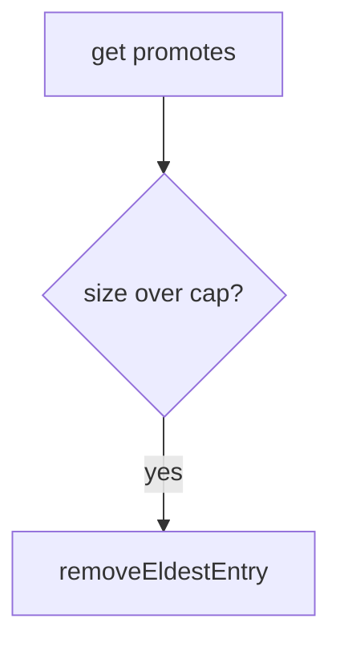

# Companion 11 — LinkedHashMap LRU

**Canonical source:** [Mastery lesson](../../../01-engineering-mastery/core-java/module-04-collections/11-linkedhashmap-lru-cache.md).

**Cheat sheet:** [Module visual quick reference](module-visual-quick-reference.md).

## Definition

LinkedHashMap with accessOrder and removeEldestEntry implements a simple LRU cache.

## Must remember

- Constructor accessOrder true.
- removeEldestEntry when size exceeds cap.
- Not thread-safe — wrap or use Caffeine for prod.
- Equals/hashCode of keys still apply.

## Interview traps

- Access-order map without a size cap is not an LRU cache.

## Interview flow

## Scenario bite

Cache last 1000 Order summaries per node: LinkedHashMap LRU; for multi-thread use a concurrent cache.

## Decision table

| Situation | Prefer |
| --- | --- |
| Single-thread LRU | LinkedHashMap |
| Concurrent prod cache | Caffeine or CHM plus policy |
| Sorted eviction | Not LinkedHashMap |

## Explain aloud (whiteboard)

1. accessOrder flag.
2. Evict eldest.
3. Not concurrent by itself.

## 30-second revision

- Access-order LinkedHashMap plus eldest removal is a teaching LRU.

## Memory hook

- **LRU** — Least Recently Used eldest.

## Cross-links

- [Module visual quick reference](module-visual-quick-reference.md)
