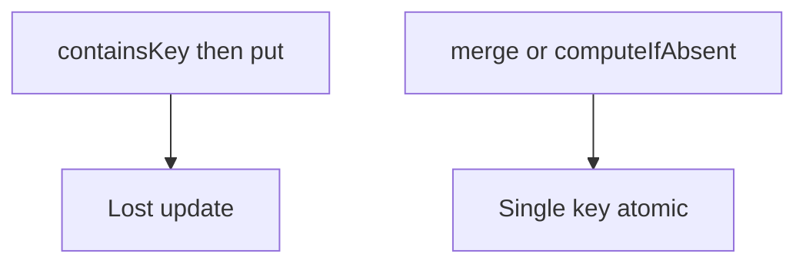

# Companion 12 — Concurrent collections overview

**Canonical source:** [Mastery lesson](../../../01-engineering-mastery/core-java/module-04-collections/12-concurrent-collections-overview.md).

**Cheat sheet:** [Module visual quick reference](module-visual-quick-reference.md).

## Definition

java.util.concurrent collections allow concurrent access with specific atomicity — not multi-key transactions.

## Must remember

- CHM merge and computeIfAbsent are single-key atomic.
- containsKey plus put races.
- Weakly consistent iterators.
- CopyOnWrite for rare writes.

## Interview traps

- CHM makes every business workflow atomic.

## Interview flow

## Scenario bite

Count payments per status: CHM.merge(status, 1L, Long::sum), not get-plus-put.

## Decision table

| Situation | Prefer |
| --- | --- |
| Single-key update | CHM atomic method |
| Multi-key transfer | Lock or DB transaction |
| Snapshot reads | Accept weak consistency or copy |

## Explain aloud (whiteboard)

1. Name the race.
2. Name the atomic API.
3. Limit of single-key.

## 30-second revision

- Concurrent collections give specific atomic ops, not full transactions.

## Memory hook

- **PCM** — putIfAbsent, compute, merge.

## Cross-links

- [Module visual quick reference](module-visual-quick-reference.md)
