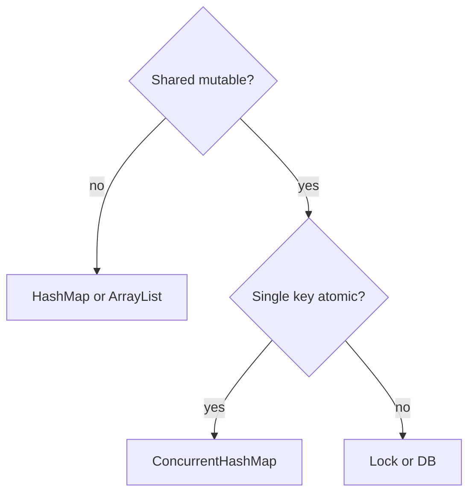

# Companion 13 — Selecting a collection

**Canonical source:** [Mastery lesson](../../../01-engineering-mastery/core-java/module-04-collections/13-selecting-the-right-collection.md).

**Cheat sheet:** [Module visual quick reference](module-visual-quick-reference.md).

## Definition

Selection is requirements first: uniqueness, order, concurrency, bounds, then the concrete class.

## Must remember

- State access pattern before the class name.
- Thread-safety is a requirement, not a default.
- Bounds and eviction for caches.
- Don't default to LinkedList or Hashtable.

## Interview traps

- Picking ConcurrentHashMap for a local method variable.

## Interview flow

## Scenario bite

Fraud rules need sorted ranges of amounts: TreeMap. Hot request cache: bounded concurrent cache, not an unbounded HashMap.

## Decision table

| Situation | Prefer |
| --- | --- |
| Local list | ArrayList |
| Shared map | CHM |
| Bounded queue | ArrayBlockingQueue |

## Explain aloud (whiteboard)

1. Requirements sentence.
2. Then class.
3. Name what you rejected.

## 30-second revision

- Requirements, then interface, then implementation.

## Memory hook

- **RAT** — Requirements, Access, Threads.

## Cross-links

- [Module visual quick reference](module-visual-quick-reference.md)
