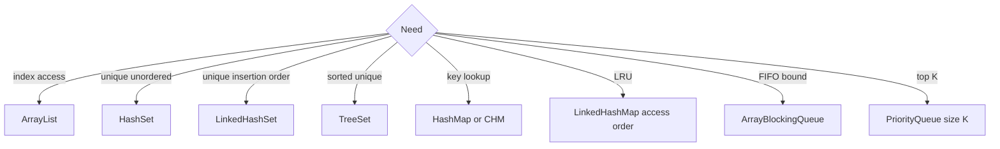

# Collections — Visual Quick Reference

[Module index](index.md). Diagrams render in MkDocs (`mkdocs serve`).

## Picker

## Rules to say aloud

| Rule | Line |
| --- | --- |
| LinkedList | Index search is O(n); not the default queue |
| Top-K largest | Size-K **min-heap** |
| Fail-fast | Not a concurrency lock |
| CHM | `merge` / `computeIfAbsent`, not contains+put |
| Queue capacity | Bounds memory, not consumer parallelism |

## Lessons

| # | Page |
| --- | --- |
| 1–13 | Companion files in this folder |
