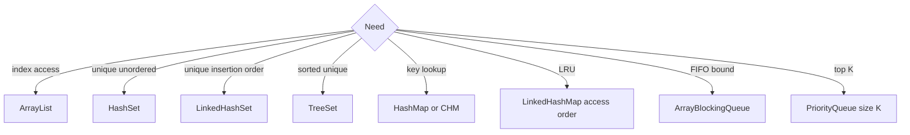

# Collections — Visual Quick Reference

[Module index](index.md). Diagrams render in MkDocs (`mkdocs serve`).

## Picker



## Rules to say aloud

| Rule | Line |
| --- | --- |
| LinkedList | Index search is O(n); not the default queue |
| Top-K largest | Size-K **min-heap** |
| Fail-fast | Not a concurrency lock |
| CHM | `merge` / `computeIfAbsent`, not contains+put |
| Queue capacity | Bounds memory, not consumer parallelism |

## Comparator recall

```java
employees.stream()
    .sorted(Comparator.comparingInt(Employee::salary)
        .reversed()
        .thenComparing(Employee::name))
    .toList();
```

| Concept | Interview line |
| --- | --- |
| `Comparable` | One natural order, declared by the type via `compareTo`. |
| `Comparator` | External, use-case-specific order via `compare`. |
| `List.sort()` | Mutates the existing list. |
| `Stream.sorted()` | Returns a stream; add a terminal operation. |
| Reversal trap | Reverse salary before `thenComparing`; otherwise both criteria reverse. |

**Memory trick:** **Natural = Comparable; custom = Comparator.**

## Lessons

| # | Page |
| --- | --- |
| 1–13 | Companion files in this folder |
