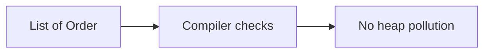

# Companion 1 — Generic classes and methods

**Canonical source:** [Mastery lesson](../../../01-engineering-mastery/core-java/module-05-generics/01-generic-classes-and-methods.md).

**Cheat sheet:** [Module visual quick reference](module-visual-quick-reference.md).

## Definition

Generics parameterize types so the compiler checks element types before erasure.

## Must remember

- class Box<T>, methods <T> T id(T x).
- Avoid raw types.
- Prefer generic methods when only the method needs T.
- Diamond operator infers.

## Interview traps

- Raw List stores anything and fails later at cast.

## Interview flow

## Scenario bite

Repository method List<Order> findByEmployee — callers cannot add a Payment without a compile error.

## Decision table

| Situation | Prefer |
| --- | --- |
| API returns entities | Generic type |
| Legacy interop | Isolate raw types at the edge |

## Explain aloud (whiteboard)

1. Declare T.
2. Show a compile error you want.
3. No raw types.

## 30-second revision

- Generics move type errors to compile time.

## Memory hook

- **GEN** — Generic, Early, No raw.

## Cross-links

- [Module visual quick reference](module-visual-quick-reference.md)
