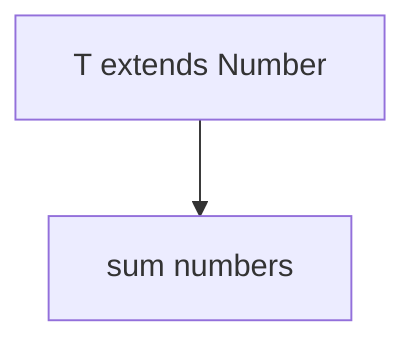

# Companion 2 — Bounds and inference

**Canonical source:** [Mastery lesson](../../../01-engineering-mastery/core-java/module-05-generics/02-bounded-type-parameters-and-inference.md).

**Cheat sheet:** [Module visual quick reference](module-visual-quick-reference.md).

## Definition

Bounds limit T (extends); inference picks type arguments from usage.

## Must remember

- <T extends Comparable<T>> for natural order.
- Multiple bounds with &.
- Target type inference on assignment.
- Explicit type witness when inference fails.

## Interview traps

- extends means inheritance only — it also allows interfaces.

## Interview flow

## Scenario bite

Utility max of employee salaries uses <T extends Comparable<? super T>> style bounds.

## Decision table

| Situation | Prefer |
| --- | --- |
| Need a capability | Bound T |
| Inference fails | Type witness |

## Explain aloud (whiteboard)

1. Write a bound.
2. Say why.
3. Mention inference.

## 30-second revision

- Bounds express required methods on T.

## Memory hook

- **EXT** — extends bound.

## Cross-links

- [Module visual quick reference](module-visual-quick-reference.md)
