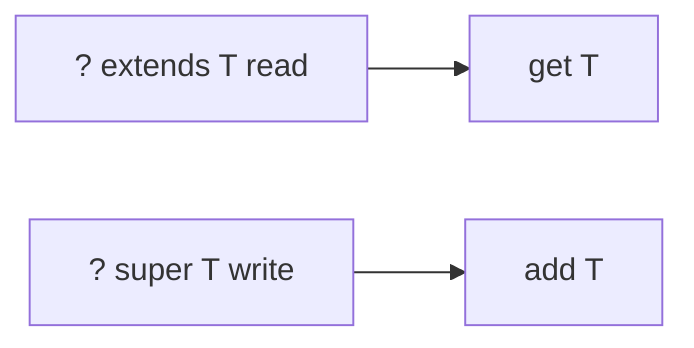

# Companion 3 — Wildcards and PECS

**Canonical source:** [Mastery lesson](../../../01-engineering-mastery/core-java/module-05-generics/03-wildcards-pecs.md).

**Cheat sheet:** [Module visual quick reference](module-visual-quick-reference.md).

## Definition

PECS: producer extends, consumer super — wildcards for flexible method parameters.

## Must remember

- List<? extends Order> read-only producer.
- List<? super Order> can accept Order.
- Do not use wildcard as a return type casually.
- Invariant generics: List<Order> is not List<Object>.

## Interview traps

- List<Order> passed where List<Object> is required.

## Interview flow

## Scenario bite

Copy orders into a list of Object: destination is List<? super Order>.

## Decision table

| Situation | Prefer |
| --- | --- |
| Read from source | ? extends |
| Write into dest | ? super |

## Explain aloud (whiteboard)

1. Say PECS.
2. Give copy example.
3. Invariance.

## 30-second revision

- Producer extends, consumer super.

## Memory hook

- **PECS**.

## Cross-links

- [Module visual quick reference](module-visual-quick-reference.md)
