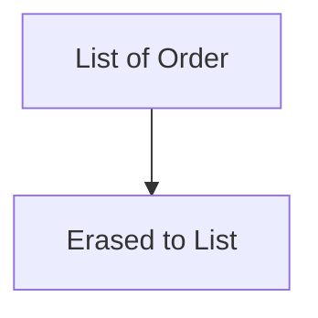

# Companion 4 — Erasure and arrays

**Canonical source:** [Mastery lesson](../../../01-engineering-mastery/core-java/module-05-generics/04-type-erasure-raw-types-arrays.md).

**Cheat sheet:** [Module visual quick reference](module-visual-quick-reference.md).

## Definition

Generics erase to bounds at runtime; you cannot make a generic array of T directly.

## Must remember

- No new T[n].
- Heap pollution via raw types and unchecked casts.
- instanceof List is not instanceof List<Order> at runtime.
- Prefer lists over generic arrays.

## Interview traps

- Reified T at runtime.

## Interview flow

## Scenario bite

A reflective cache cannot new Order[n] from T; use ArrayList<Order> or Array.newInstance with a Class token.

## Decision table

| Situation | Prefer |
| --- | --- |
| Need runtime class | Class<T> token |
| Storage | ArrayList |

## Explain aloud (whiteboard)

1. What erasure removes.
2. Why arrays clash.
3. Class token.

## 30-second revision

- Erasure removes type arguments; arrays are reified.

## Memory hook

- **ERA** — Erasure, Runtime arrays differ.

## Cross-links

- [Module visual quick reference](module-visual-quick-reference.md)
