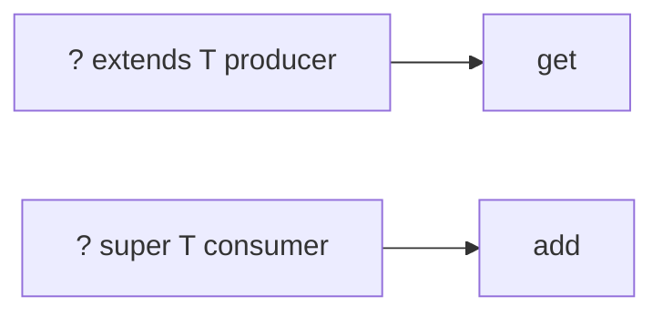

# Generics — Visual Quick Reference

| Topic | Line |
| --- | --- |
| PECS | Producer extends, consumer super |
| Invariance | `List<Order>` is not `List<Object>` |
| Erasure | type arguments gone at runtime; no `new T[]` |

- [01 classes](01-generic-classes-and-methods.md)
- [02 bounds](02-bounded-type-parameters-and-inference.md)
- [03 PECS](03-wildcards-pecs.md)
- [04 erasure](04-type-erasure-raw-types-arrays.md)
