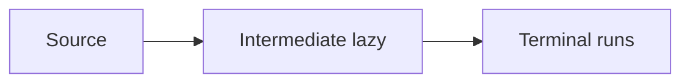

# Companion 1 — Stream pipelines

**Canonical source:** [Mastery lesson](../../../01-engineering-mastery/core-java/module-06-java-8-streams/01-stream-pipeline-fundamentals.md).

**Cheat sheet:** [Module visual quick reference](module-visual-quick-reference.md).

## Definition

Streams are lazy pipelines: intermediate ops build a recipe; a terminal op runs it.

## Must remember

- filter/map/flatMap intermediate.
- collect/forEach/reduce terminal.
- Source is not mutated by map.
- One terminal per stream.
- `findFirst()` returns `Optional`; `findAny()` need not preserve encounter order.
- `map` is one-to-one; `flatMap` flattens zero-to-many child streams.

## Interview traps

- Stream runs at map time — it doesn't.

## Interview flow

## Scenario bite

Filter unpaid orders then map to ids — nothing runs until collect.

## Decision table

| Situation | Prefer |
| --- | --- |
| Transform | map |
| Flatten lists | flatMap |
| Need a list | collect |

## Explain aloud (whiteboard)

1. Lazy vs terminal.
2. One pipeline.
3. Don't reuse a consumed stream.

## 30-second revision

- Intermediate lazy, terminal executes.

## Memory hook

- **LIT** — Lazy intermediate, Terminal.

## Cross-links

- [Module visual quick reference](module-visual-quick-reference.md)
