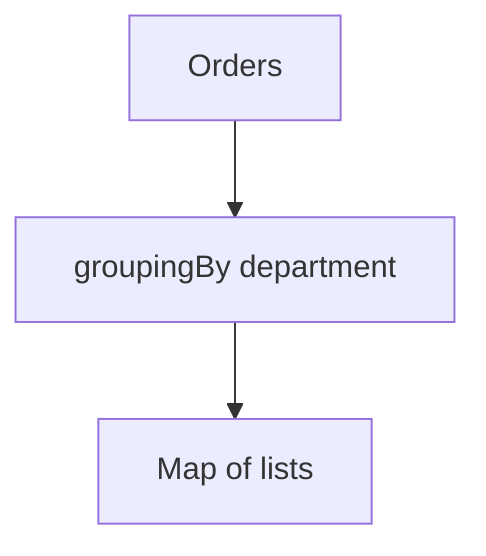

# Companion 2 — Collectors

**Canonical source:** [Mastery lesson](../../../01-engineering-mastery/core-java/module-06-java-8-streams/02-aggregation-collectors.md).

**Cheat sheet:** [Module visual quick reference](module-visual-quick-reference.md).

## Definition

Collectors accumulate stream elements into lists, maps, groups, and summaries.

## Must remember

- toList, groupingBy, partitioningBy.
- Downstream collectors (counting, summing).
- toMap needs a merge function on key clash.
- groupingBy is not thread-safe unless concurrent collector.

## Interview traps

- toMap without merge on duplicate keys.

## Interview flow

## Scenario bite

Group orders by employee id for a payroll report: groupingBy(Order::employeeId).

## Decision table

| Situation | Prefer |
| --- | --- |
| List | toList |
| Group | groupingBy |
| Duplicate keys | toMap merge |

## Explain aloud (whiteboard)

1. Name the collector.
2. Duplicate key policy.
3. Downstream if needed.

## 30-second revision

- Collectors are the terminal accumulation strategy.

## Memory hook

- **GRP** — Group, Reduce, Partition.

## Cross-links

- [Module visual quick reference](module-visual-quick-reference.md)
