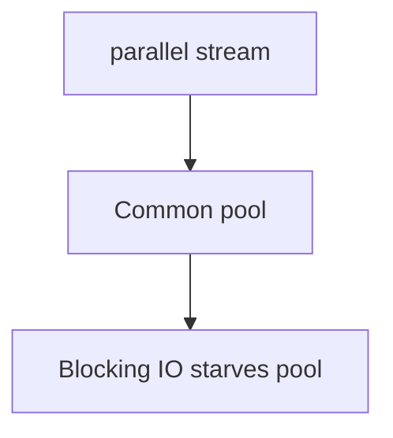

# Companion 4 — Parallel streams

**Canonical source:** [Mastery lesson](../../../01-engineering-mastery/core-java/module-06-java-8-streams/04-correctness-parallel-performance.md).

**Cheat sheet:** [Module visual quick reference](module-visual-quick-reference.md).

## Definition

parallel() uses the common ForkJoinPool and requires stateless, non-interfering ops.

## Must remember

- Don't block in parallel streams.
- Shared mutable ArrayList in forEach is wrong.
- Small data can be slower in parallel.
- Order is not free (forEachOrdered).

## Interview traps

- parallel() always faster.

## Interview flow

## Scenario bite

Pricing 50 orders with a blocking HTTP call inside parallel map saturates the common pool.

## Decision table

| Situation | Prefer |
| --- | --- |
| CPU split of large array | parallel with care |
| Blocking IO | Virtual threads or own pool |

## Explain aloud (whiteboard)

1. Which pool.
2. No shared mutation.
3. Measure.

## 30-second revision

- Parallel streams share the common pool; keep work CPU-bound and stateless.

## Memory hook

- **FORK** — ForkJoin common pool.

## Cross-links

- [Module visual quick reference](module-visual-quick-reference.md)
