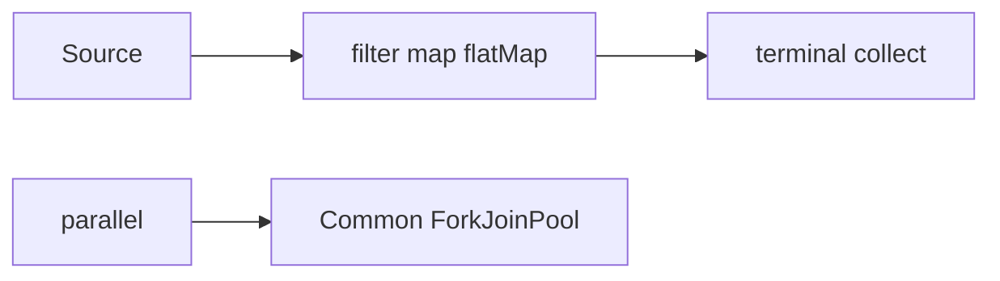

# Streams — Visual Quick Reference

| Pitfall | Fix |
| --- | --- |
| Assume map runs immediately | Need a terminal op |
| `toMap` duplicate keys | Merge function |
| Blocking work in `parallel()` | Own pool or virtual threads |

- [01 pipeline](01-stream-pipeline-fundamentals.md)
- [02 collectors](02-aggregation-collectors.md)
- [03 short-circuit](03-search-short-circuit-primitives.md)
- [04 parallel](04-correctness-parallel-performance.md)
