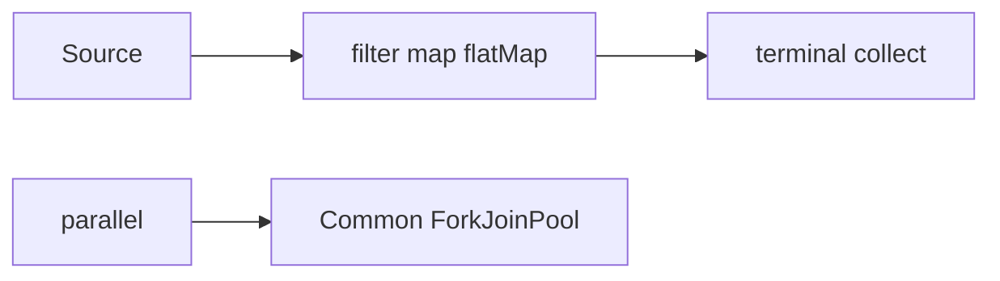

# Streams — Visual Quick Reference



| Pitfall | Fix |
| --- | --- |
| Assume map runs immediately | Need a terminal op |
| `toMap` duplicate keys | Merge function |
| Blocking work in `parallel()` | Own pool or virtual threads |

## Salary and collector recall

```java
employees.stream().map(Employee::salary).distinct()
    .sorted(Comparator.reverseOrder()).skip(1).findFirst();
```

| Need | Say / use |
| --- | --- |
| Second highest distinct value | `distinct` -> descending `sorted` -> `skip(1)` -> `findFirst` |
| Fewer than two values | `Optional`: `orElse`, lazy `orElseGet`, or `orElseThrow` |
| Department maximum | `groupingBy(key, maxBy(comparator))` |
| Required nonempty group result | `collectingAndThen(maxBy(...), Optional::orElseThrow)` |
| Nested lists | `map` gives `Stream<Stream<T>>`; `flatMap` gives `Stream<T>` |

**Interview answer:** “`findFirst` returns Optional because absence is valid; I do not build a
list just to use index zero. `maxBy` avoids sorting each group and is linear.”

**Memory trick:** **M-D-S-S-F** — Map, Distinct, Sort, Skip, First.

- [01 pipeline](01-stream-pipeline-fundamentals.md)
- [02 collectors](02-aggregation-collectors.md)
- [03 short-circuit](03-search-short-circuit-primitives.md)
- [04 parallel](04-correctness-parallel-performance.md)
