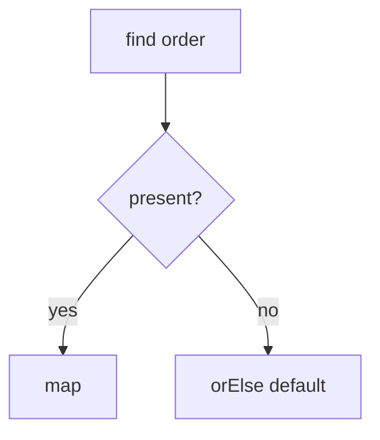

# Companion 1 — Optional fundamentals

**Canonical source:** [Mastery lesson](../../../01-engineering-mastery/core-java/module-07-optional/01-optional-fundamentals.md).

**Cheat sheet:** [Module visual quick reference](module-visual-quick-reference.md).

## Definition

Optional is a return type for a value that may be absent — not a field or parameter default.

## Must remember

- orElse vs orElseGet (eager vs lazy).
- Do not call get() without presence check.
- orElseThrow for required values.
- Empty means absent, not null inside.

## Interview traps

- Optional as a field in JPA entities.

## Interview flow

## Scenario bite

Order lookup by id returns Optional; controller uses orElseThrow for 404.

## Decision table

| Situation | Prefer |
| --- | --- |
| Default cheap | orElse |
| Default expensive | orElseGet |
| Must exist | orElseThrow |

## Explain aloud (whiteboard)

1. Return type only.
2. orElse vs orElseGet.
3. No get().

## 30-second revision

- Optional for absence at API boundaries.

## Memory hook

- **OPT** — OrElse, Presence, Throw.

## Cross-links

- [Module visual quick reference](module-visual-quick-reference.md)
