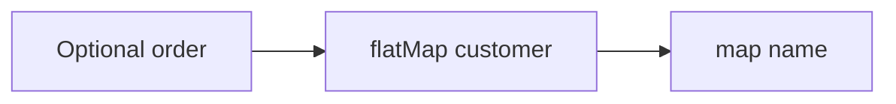

# Companion 2 — Optional composition

**Canonical source:** [Mastery lesson](../../../01-engineering-mastery/core-java/module-07-optional/02-optional-composition-and-antipatterns.md).

**Cheat sheet:** [Module visual quick reference](module-visual-quick-reference.md).

## Definition

map and flatMap chain Optional without nested null checks.

## Must remember

- map when function returns a value.
- flatMap when function returns Optional.
- Don't use Optional.get in streams.
- filter on Optional for conditional presence.

## Interview traps

- optional.map(x -> optionalOf(x)) nests — use flatMap.

## Interview flow

## Scenario bite

Order to optional customer to email: flatMap then map, never get() in the middle.

## Decision table

| Situation | Prefer |
| --- | --- |
| Function returns T | map |
| Function returns Optional | flatMap |

## Explain aloud (whiteboard)

1. map vs flatMap.
2. One chain.
3. Avoid get.

## 30-second revision

- flatMap flattens nested Optional.

## Memory hook

- **FLAT**.

## Cross-links

- [Module visual quick reference](module-visual-quick-reference.md)
