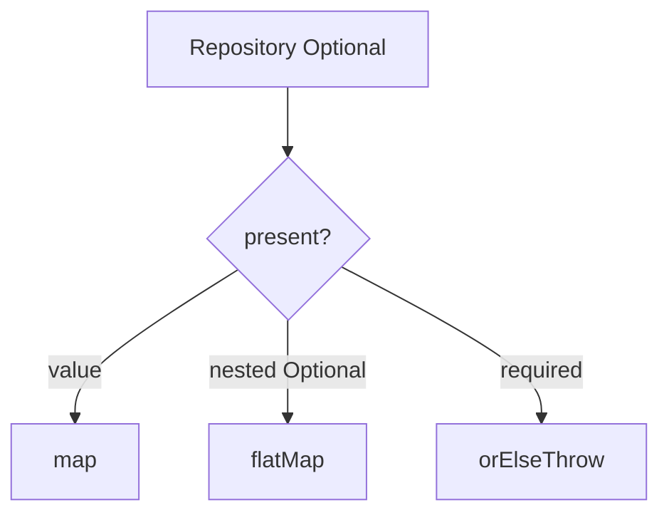

# Optional — Visual Quick Reference

| API | Use |
| --- | --- |
| `orElse` | Cheap default |
| `orElseGet` | Expensive default |
| `map` | `T → U` |
| `flatMap` | `T → Optional<U>` |

- [01 fundamentals](01-optional-fundamentals.md)
- [02 composition](02-optional-composition-and-antipatterns.md)
