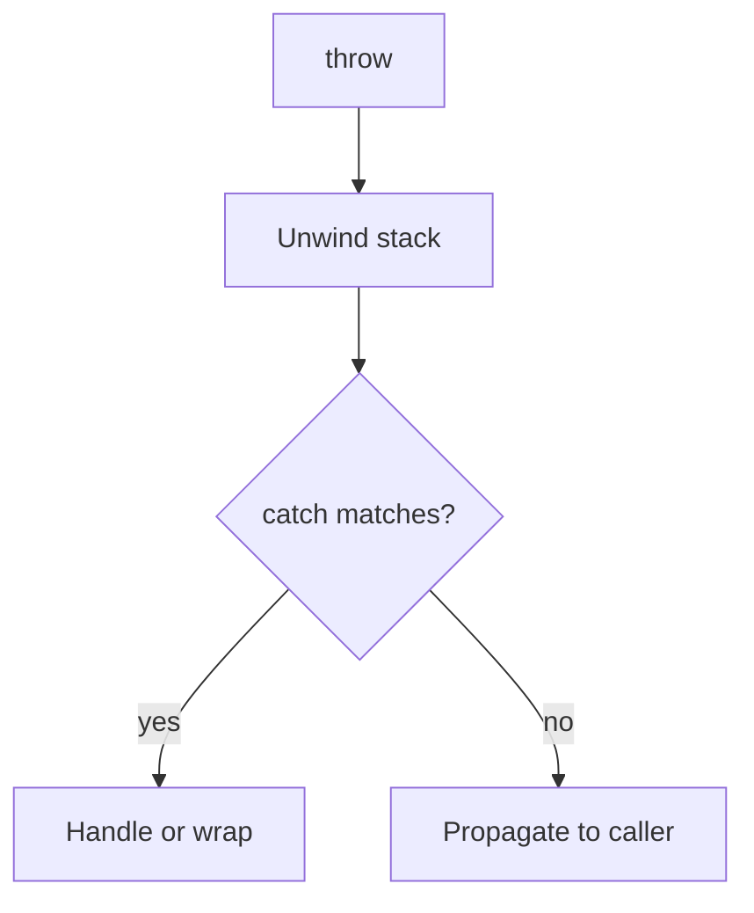

# Companion 1 — Throwable hierarchy

**Canonical source:** [Mastery lesson](../../../01-engineering-mastery/core-java/module-08-exception-handling/01-throwable-hierarchy-and-propagation.md).

**Cheat sheet:** [Module visual quick reference](module-visual-quick-reference.md).

## Definition

Java errors and exceptions form a hierarchy: Error, Exception, checked vs unchecked — propagation follows the call stack until caught or the thread dies.

## Must remember

- Throwable → Error (JVM) vs Exception.
- Checked exceptions must be declared or caught; RuntimeException is unchecked.
- Catch the narrowest type you can handle; do not swallow.
- Use exceptions for exceptional paths, not control flow in hot loops.

## Interview traps

- Catching Exception hides bugs — catch specific types.
- Error is not for application catch-all (OutOfMemoryError).

## Interview flow

## Scenario bite

Payment API throws a checked validation failure at the controller boundary; a NullPointerException deeper in mapping should not be mapped to the same 400.

## Decision table

| Situation | Prefer |
| --- | --- |
| Client mistake | Unchecked or domain exception → 4xx |
| Dependency down | Wrap and retry policy, often 503 |
| Programmer bug | Let unchecked fail fast, fix code |

## Explain aloud (whiteboard)

1. Name checked vs unchecked.
2. Show stack unwind until a handler.
3. Say what you would not catch (Error, broad Exception).

## 30-second revision

- Checked must be handled; unchecked signals bugs or domain policy you choose to declare.

## Memory hook

- **CUE** — Checked, Unchecked, Error.

## Cross-links

- [Module visual quick reference](module-visual-quick-reference.md)
