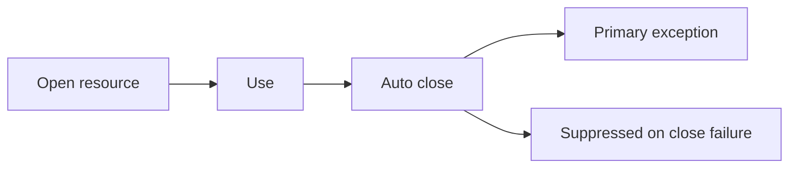

# Companion 2 — Try-with-resources and wrapping

**Canonical source:** [Mastery lesson](../../../01-engineering-mastery/core-java/module-08-exception-handling/02-try-with-resources-and-wrapping.md).

**Cheat sheet:** [Module visual quick reference](module-visual-quick-reference.md).

## Definition

try-with-resources closes AutoCloseable in reverse order and can suppress secondary exceptions; wrapping preserves the cause chain.

## Must remember

- Resources close even when the body throws.
- Suppressed exceptions attach to the primary via getSuppressed().
- Wrap with cause: new ServiceException(msg, cause).
- Do not lose the original stack when translating to HTTP.

## Interview traps

- Empty catch after close — leaks the real failure.
- Wrapping without cause drops diagnostics.

## Interview flow

## Scenario bite

Reading an order export file: if parsing throws and close also throws, the parse exception stays primary and close is suppressed.

## Decision table

| Situation | Prefer |
| --- | --- |
| Need deterministic close | try-with-resources |
| Translate to API type | Wrap with cause |
| Log and continue | Only if failure is truly optional |

## Explain aloud (whiteboard)

1. Open, use, auto-close order.
2. Primary vs suppressed.
3. Always pass cause when wrapping.

## 30-second revision

- try-with-resources closes reliably; wrapping must keep the cause.

## Memory hook

- **WRAP** — With cause, Reverse close, Attach suppressed, Primary wins.

## Cross-links

- [Module visual quick reference](module-visual-quick-reference.md)
