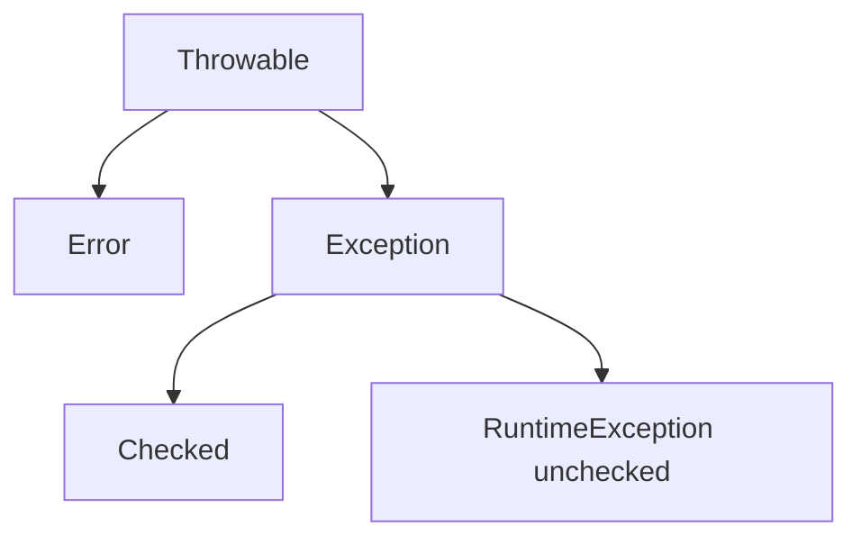

# Exceptions — Visual Quick Reference

## Hierarchy

## Retry

| Failure | Action |
| --- | --- |
| 503, timeout | Bounded retry, same idempotency key |
| 400 validation | Do not retry |
| Timeout after charge | Query provider, do not new charge |

See also [Concurrency L22 companion](../../concurrency/22-backend-concurrency-scenarios.md).

## Lessons

- [01 hierarchy](01-throwable-hierarchy-and-propagation.md)
- [02 try-with-resources](02-try-with-resources-and-wrapping.md)
- [03 retries and idempotency](03-production-spring-retries-idempotency.md)
