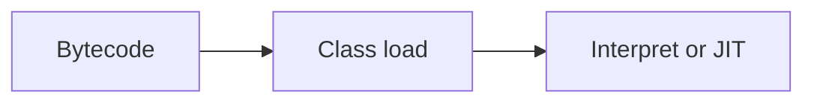

# Companion 1 — JVM architecture

**Canonical source:** [Mastery lesson](../../../01-engineering-mastery/core-java/module-09-jvm-basics/01-jvm-architecture-and-execution-lifecycle.md).

**Cheat sheet:** [Module visual quick reference](module-visual-quick-reference.md).

## Definition

The JVM loads bytecode, verifies, interprets or JIT-compiles, and runs threads on the host OS.

## Must remember

- Class loaders, bytecode, JIT.
- java vs javac.
- Shutdown hooks are last resort.
- Platform threads map toward OS threads.

## Interview traps

- JIT means every method is native immediately.

## Interview flow

## Scenario bite

A payment service cold start is slow until JIT warms hot methods.

## Decision table

| Situation | Prefer |
| --- | --- |
| Startup | Class loading |
| Steady state | JIT |

## Explain aloud (whiteboard)

1. Load then execute.
2. JIT warms up.
3. Not the same as OS.

## 30-second revision

- JVM loads and executes bytecode, optimizing hot paths.

## Memory hook

- **JIT**.

## Cross-links

- [Module visual quick reference](module-visual-quick-reference.md)
