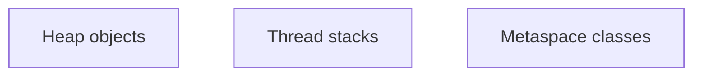

# Companion 2 — Runtime memory areas

**Canonical source:** [Mastery lesson](../../../01-engineering-mastery/core-java/module-09-jvm-basics/02-jvm-runtime-memory-areas.md).

**Cheat sheet:** [Module visual quick reference](module-visual-quick-reference.md).

## Definition

Heap holds objects; stacks hold frames; metaspace holds class metadata.

## Must remember

- Heap shared; stacks per thread.
- Metaspace is native, not the old perm gen.
- GC manages heap.
- Thread stacks size is configurable.

## Interview traps

- All memory is heap.

## Interview flow

## Scenario bite

Many virtual threads with deep stacks still use memory; large ThreadLocals sit on the heap.

## Decision table

| Situation | Prefer |
| --- | --- |
| Object leak | Heap |
| Class leak | Metaspace |

## Explain aloud (whiteboard)

1. Name three areas.
2. What GC collects.
3. Per-thread stack.

## 30-second revision

- Heap, stacks, metaspace — different leaks.

## Memory hook

- **HSM** — Heap, Stack, Metaspace.

## Cross-links

- [Module visual quick reference](module-visual-quick-reference.md)
