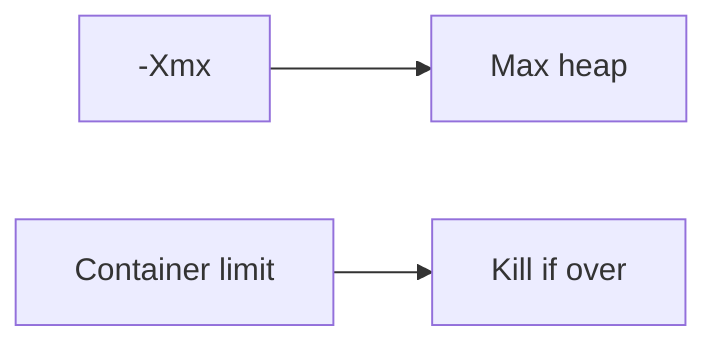

# Companion 3 — JVM memory options

**Canonical source:** [Mastery lesson](../../../01-engineering-mastery/core-java/module-09-jvm-basics/03-jvm-memory-configuration-and-options.md).

**Cheat sheet:** [Module visual quick reference](module-visual-quick-reference.md).

## Definition

Flags set heap, metaspace, and GC behavior; defaults differ by ergonomics.

## Must remember

- -Xms/-Xmx heap.
- MetaspaceSize.
- Always set Xmx in containers.
- Container awareness matters.

## Interview traps

- Unlimited heap inside a small container.

## Interview flow

## Scenario bite

Pod with 512Mi and -Xmx2g is killed by the cgroup, not a clean Java OOM.

## Decision table

| Situation | Prefer |
| --- | --- |
| Container | Size heap under limit |
| Batch | Larger heap, measure GC |

## Explain aloud (whiteboard)

1. Name Xmx.
2. Container interaction.
3. Don't guess.

## 30-second revision

- Set heap inside the container budget.

## Memory hook

- **XMX**.

## Cross-links

- [Module visual quick reference](module-visual-quick-reference.md)
