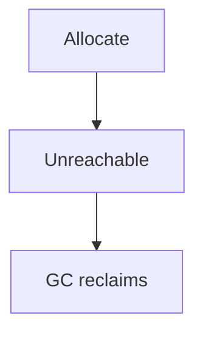

# Companion 4 — GC fundamentals

**Canonical source:** [Mastery lesson](../../../01-engineering-mastery/core-java/module-09-jvm-basics/04-garbage-collection-fundamentals.md).

**Cheat sheet:** [Module visual quick reference](module-visual-quick-reference.md).

## Definition

GC reclaims unreachable objects; pauses and throughput trade off.

## Must remember

- Reachability from GC roots.
- Minor vs major collections depend on collector.
- Allocation rate drives GC.
- Finalizers are obsolete.

## Interview traps

- GC runs only when heap is 100% — it runs by policy.

## Interview flow

## Scenario bite

Caching every Order forever removes reachability — GC cannot help; bound the cache.

## Decision table

| Situation | Prefer |
| --- | --- |
| High alloc | Reduce garbage |
| Long pause | Collector and heap tuning |

## Explain aloud (whiteboard)

1. Roots and reachability.
2. Bound caches.
3. Pause vs throughput.

## 30-second revision

- Unreachable objects are collected; leaks stay reachable.

## Memory hook

- **ROOT**.

## Cross-links

- [Module visual quick reference](module-visual-quick-reference.md)
