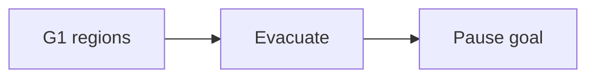

# Companion 5 — Collectors and G1

**Canonical source:** [Mastery lesson](../../../01-engineering-mastery/core-java/module-09-jvm-basics/05-garbage-collectors-and-g1.md).

**Cheat sheet:** [Module visual quick reference](module-visual-quick-reference.md).

## Definition

G1 is a regional collector aimed at pause goals; other collectors optimize throughput or latency differently.

## Must remember

- G1 uses regions and a pause target.
- Know your JDK default.
- Don't tune blindly.
- ZGC/Shenandoah are low-pause options on newer JDKs.

## Interview traps

- One collector is best for every service.

## Interview flow

## Scenario bite

Latency-sensitive payment API: measure p99 pause; consider G1 pause target or a low-latency collector if the JDK supports it.

## Decision table

| Situation | Prefer |
| --- | --- |
| Throughput batch | Measure, maybe throughput collector |
| Tight p99 | Low-pause collector |

## Explain aloud (whiteboard)

1. Name G1 idea.
2. Measure first.
3. JDK version matters.

## 30-second revision

- Pick a collector from pause and throughput goals, then measure.

## Memory hook

- **G1** — regions and pause goals.

## Cross-links

- [Module visual quick reference](module-visual-quick-reference.md)
