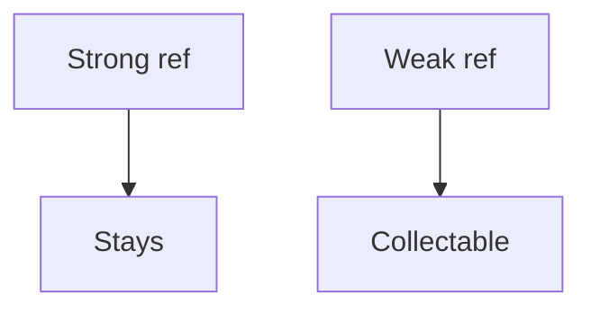

# Companion 6 — Reference types

**Canonical source:** [Mastery lesson](../../../01-engineering-mastery/core-java/module-09-jvm-basics/06-java-reference-types-and-memory-retention.md).

**Cheat sheet:** [Module visual quick reference](module-visual-quick-reference.md).

## Definition

Strong refs keep objects; soft, weak, and phantom refs allow earlier collection or post-mortem cleanup.

## Must remember

- Strong is the default.
- WeakHashMap drops entries when keys are weakly reachable.
- Soft refs are cache-ish but not a size cap.
- Don't build caches only from soft refs.

## Interview traps

- WeakHashMap as an LRU.
- `ConcurrentHashMap` means an unbounded singleton cache is GC-safe.

## Interview flow

## Scenario bite

A metadata cache keyed by Class should not pin class loaders; weak keys can help, but still cap size.

## Decision table

| Situation | Prefer |
| --- | --- |
| Must stay | Strong |
| Optional cache | Bounded strong cache, not only soft |

## Explain aloud (whiteboard)

1. Four reference strengths briefly.
2. WeakHashMap caveat.
3. Prefer explicit eviction.

## 30-second revision

- Strong refs retain; weak refs do not replace a capacity policy.

**Cache recall:** Objects strongly reachable from an unbounded singleton cache remain live to the
GC. Bound size/weight/TTL and monitor old gen, evictions, hit/miss, and load latency.

## Memory hook

- **SWE** — Strong, Weak, Evict explicitly.

## Cross-links

- [Module visual quick reference](module-visual-quick-reference.md)
