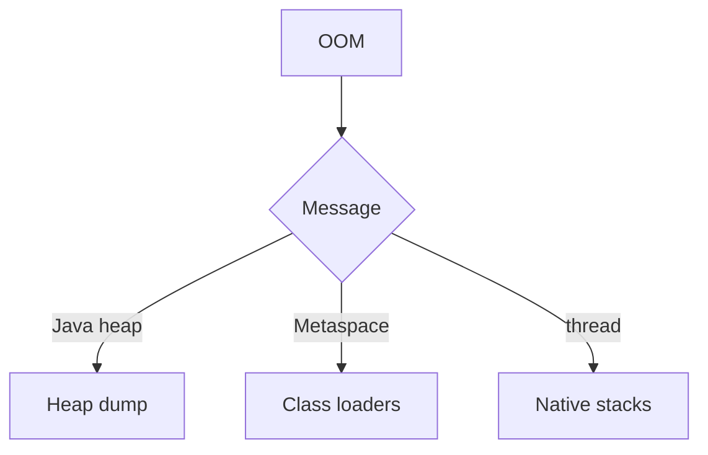

# Companion 7 — Diagnosing OOM

**Canonical source:** [Mastery lesson](../../../01-engineering-mastery/core-java/module-09-jvm-basics/07-diagnosing-outofmemoryerror-in-production.md).

**Cheat sheet:** [Module visual quick reference](module-visual-quick-reference.md).

## Definition

OutOfMemoryError names the area: heap, metaspace, or unable to create thread.

## Must remember

- Read the message subtype.
- Heap dump on heap OOM if policy allows.
- Thread OOM is often native memory or thread count.
- Correlate deploy and traffic.

## Interview traps

- Every OOM is heap.

## Interview flow

## Scenario bite

After a deploy, metaspace OOM points at classloader leaks, not a bigger order cache.

## Decision table

| Situation | Prefer |
| --- | --- |
| Java heap space | Dump and dominators |
| Metaspace | Class loaders |
| Unable to create native thread | Thread count |

## Explain aloud (whiteboard)

1. Read the subtype.
2. Pick the tool.
3. Don't just raise Xmx.

## 30-second revision

- The OOM message selects the investigation.

## Memory hook

- **MSG** — Message guides the tool.

## Cross-links

- [Module visual quick reference](module-visual-quick-reference.md)
