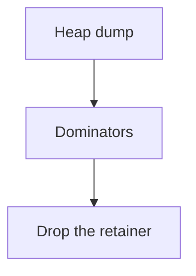

# Companion 8 — Heap dump analysis

**Canonical source:** [Mastery lesson](../../../01-engineering-mastery/core-java/module-09-jvm-basics/08-heap-dump-analysis.md).

**Cheat sheet:** [Module visual quick reference](module-visual-quick-reference.md).

## Definition

A heap dump shows retained sets and dominators — who keeps objects alive.

## Must remember

- Capture with jcmd or on OOM.
- Look at dominator tree.
- Shallow vs retained size.
- Redact secrets in dumps.

## Interview traps

- Largest shallow object is always the leak.

## Interview flow

## Scenario bite

Order cache map dominates the heap after a bug removed eviction.

## Decision table

| Situation | Prefer |
| --- | --- |
| Leak | Dominator path |
| One-off spike | Compare two dumps |

## Explain aloud (whiteboard)

1. Retained size.
2. Dominator.
3. Fix the retainer.

## 30-second revision

- Follow dominators to the retainer.

## Memory hook

- **DOM**.

## Cross-links

- [Module visual quick reference](module-visual-quick-reference.md)
