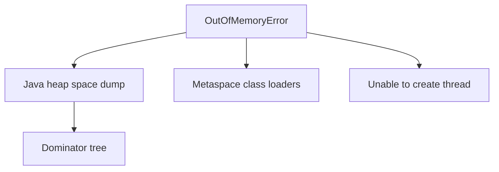

# JVM — Visual Quick Reference

| Area | Holds |
| --- | --- |
| Heap | Objects |
| Stack | Frames per thread |
| Metaspace | Class metadata |

| Signal | First move |
| --- | --- |
| Heap OOM | Dump, find retainer, bound cache |
| Container kill | `-Xmx` vs cgroup |
| High alloc | Reduce garbage before collector folklore |

Lessons 01–09 in this folder.
