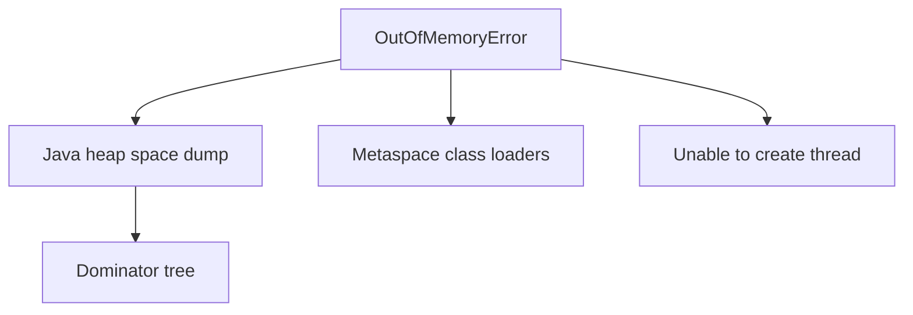
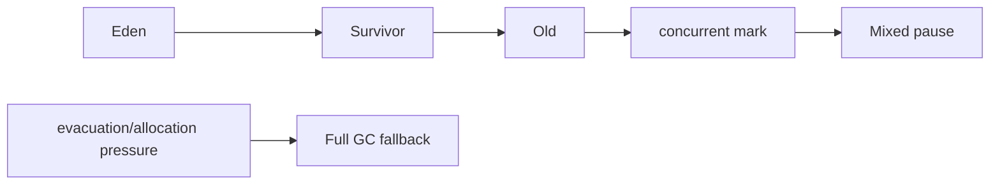

# JVM — Visual Quick Reference

| Area | Holds |
| --- | --- |
| Heap | Objects |
| Stack | Frames per thread |
| Metaspace | Class metadata |

| Signal | First move |
| --- | --- |
| Heap OOM | Dump, find retainer, bound cache |
| Container kill | `-Xmx` vs cgroup |
| High alloc | Reduce garbage before collector folklore |

## G1, diagnosis, and P99 in one minute

| Topic | Say this | Do not say |
| --- | --- | --- |
| G1 | Young evacuations; concurrent marking informs mixed collections; Full GC is a costly fallback. | G1 is pause-free or Full GC proves a leak. |
| SATB | Conservative concurrent marking can retain a post-snapshot dead object until a later cycle. | Full GC simply reuses a complete concurrent mark. |
| NMT | `VM.native_memory summary` needs startup NMT. | NMT lists every native allocation. |
| MAT | Histogram -> dominator -> retained heap -> GC roots. | One large object proves a leak. |
| P99 | Near-tail threshold; define the measured unit first. | P99 is an average or says 99% got faster. |

Lessons 01–09 in this folder.
