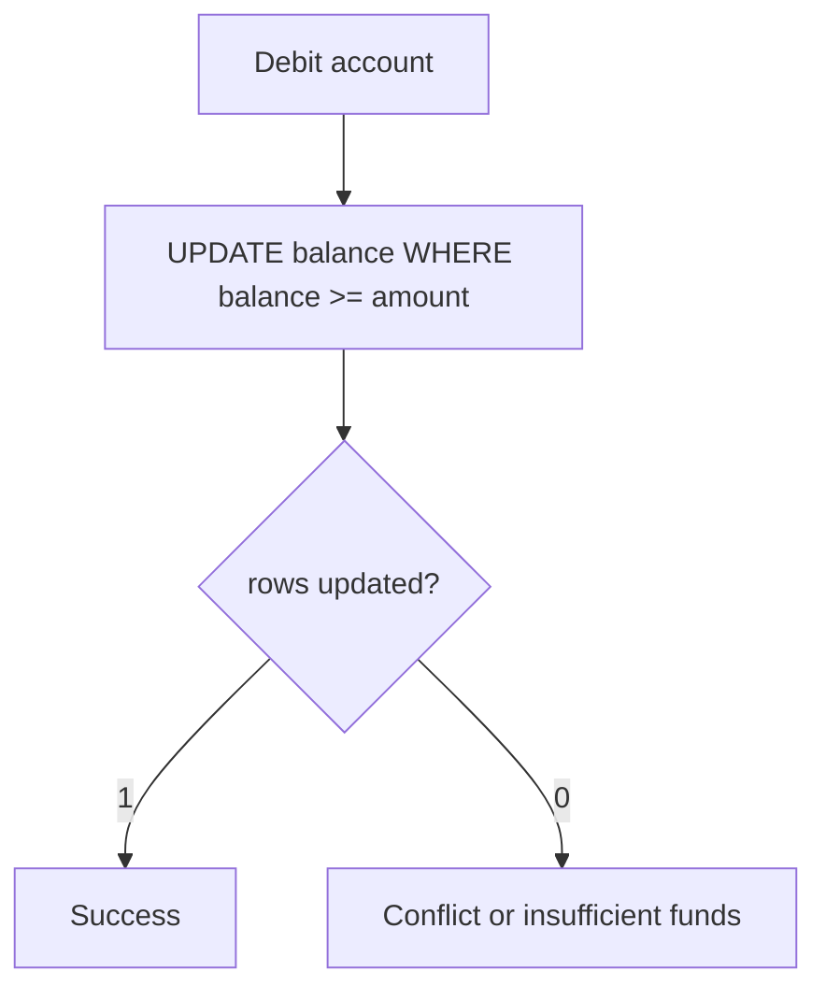
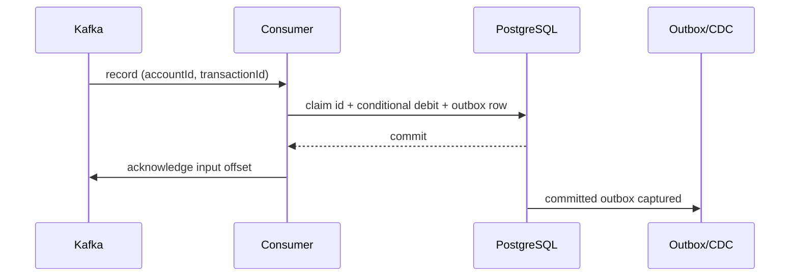

# Distributed systems — Visual Quick Reference

Canonical pages:

- [Database concurrency and isolation](../../../distributed-systems/database-concurrency-and-isolation.md)
- [Locks, fencing, ScyllaDB](../../../distributed-systems/distributed-locks-fencing-and-scylladb.md)

## Lost update vs lock

| Mechanism | Say this |
| --- | --- |
| Optimistic `@Version` | Retry on conflict; rate is workload-specific |
| `SELECT FOR UPDATE` | Pessimistic row lock; watch lock order |
| JVM `synchronized` | Does not cover other instances |
| Fencing token | Works only if storage rejects stale tokens |
| Synthetic sharding | Changes query shape; not a free speedup |

## When both appear

Kafka between services; database conditional update for money; in-process queue only inside one JVM.

## Kafka, idempotency, and outbox recall

| Topic | 30-second interview line | Trap |
| --- | --- | --- |
| Kafka ordering | Order is per partition; key by `accountId` for an account sequence. | `transactionId` usually disperses one account's events. |
| Debit | One conditional `UPDATE ... WHERE balance >= amount`; check row count. | SELECT then UPDATE races across instances. |
| Duplicate replay | Unique `transactionId` claim makes retry/replay idempotent. | Exactly-once business effect is not exactly-once delivery. |
| Flush | Sends deferred SQL; does not commit. | `save()` always proves unique claim now. |
| Outbox | Business update and event intent commit together; CDC publishes later. | CDC outage rolls back an already committed DB transaction. |

**Memory trick:** **Key -> Claim -> Debit -> Outbox -> Ack.**
