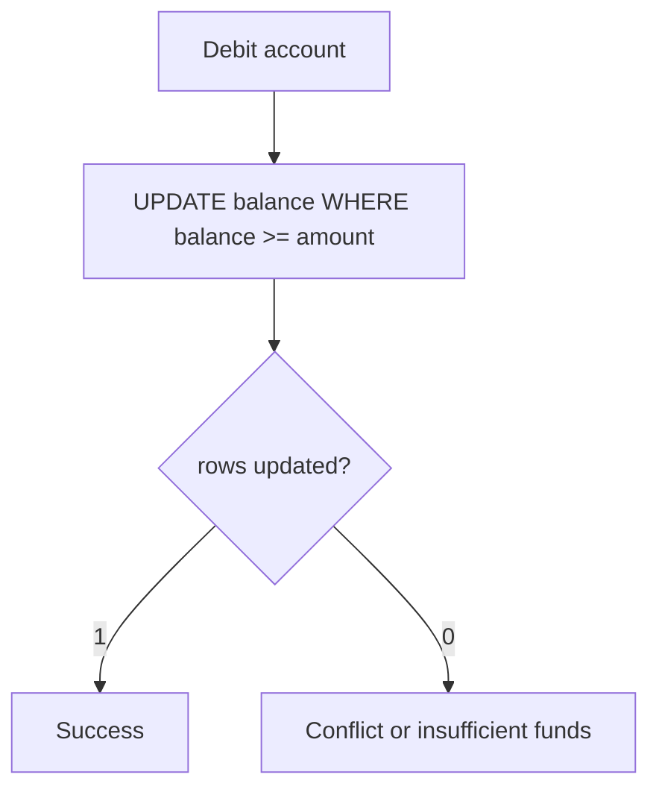

# Distributed systems — Visual Quick Reference

Canonical pages:

- [Database concurrency and isolation](../../../distributed-systems/database-concurrency-and-isolation.md)
- [Locks, fencing, ScyllaDB](../../../distributed-systems/distributed-locks-fencing-and-scylladb.md)

## Lost update vs lock

| Mechanism | Say this |
| --- | --- |
| Optimistic `@Version` | Retry on conflict; rate is workload-specific |
| `SELECT FOR UPDATE` | Pessimistic row lock; watch lock order |
| JVM `synchronized` | Does not cover other instances |
| Fencing token | Works only if storage rejects stale tokens |
| Synthetic sharding | Changes query shape; not a free speedup |

## When both appear

Kafka between services; database conditional update for money; in-process queue only inside one JVM.
