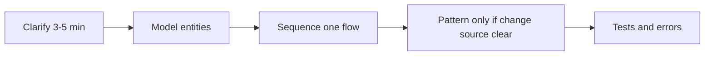
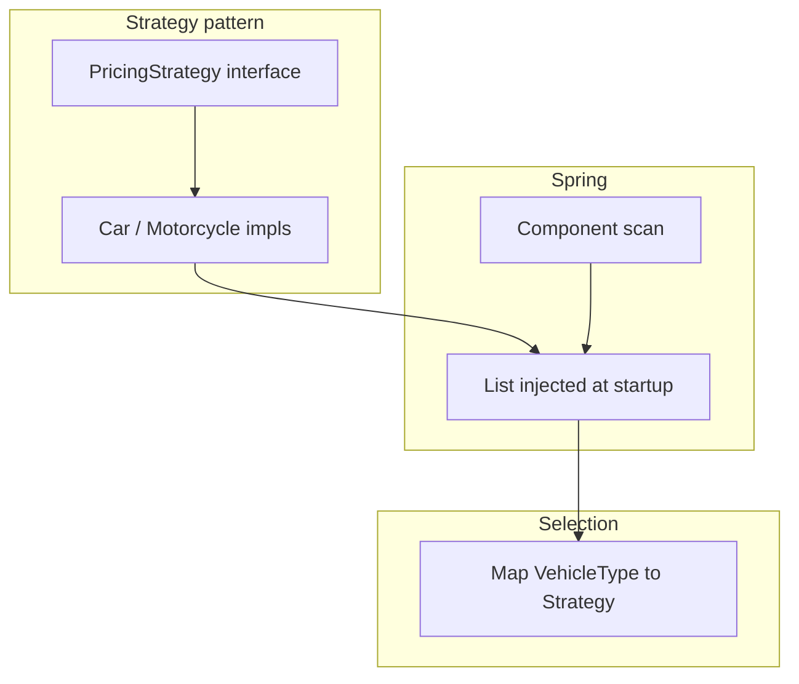
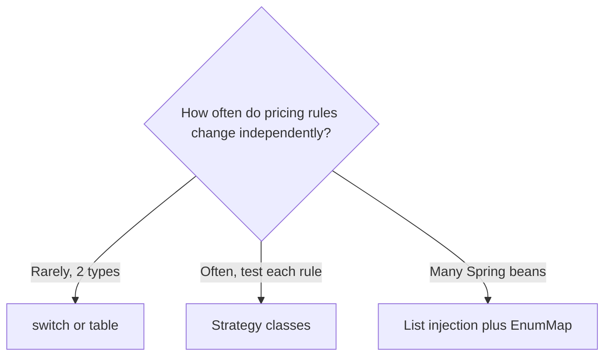
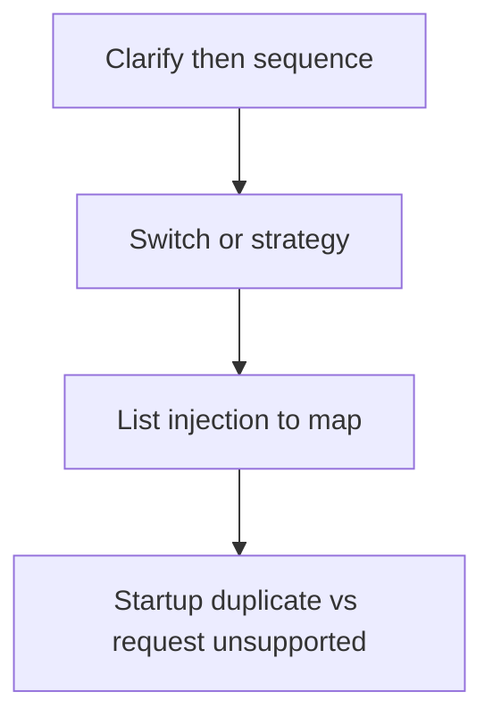

# Companion 1 — LLD Foundations

**Canonical source:** [Mastery Lesson 1](../../../01-engineering-mastery/lld/module-05-lld/01-lld-foundations-what-senior-lld-interviews-evaluate.md).

## Definition

**LLD** interviews test object modeling, responsibilities, interactions, extensibility, and trade-offs in a bounded problem — usually one service or library — not full multi-region architecture.

## Why it exists

Senior roles must design maintainable modules, not only code features; interviewers probe judgment before patterns.

## Must remember

- **HLD** = boxes, scale, consistency across services; **LLD** = classes, methods, sequences.
- Full HLD first is **not** mandatory when prompt is single-process — **state assumptions**.
- Workflow: clarify → scope → nouns → responsibilities → relationships → trace paths → API → tests → trade-offs.
- **Switch** OK for small stable rules; **Strategy + registry** when pricing/rules diverge.
- **Strategy ≠ registry ≠ Spring** — three separate ideas.
- Duplicate strategy key → **startup** failure; unknown type at runtime → **unsupported** (often 4xx), not duplicate config.
- Money → **`BigDecimal`**, not `double`.
- Patterns/maps are not automatically “more senior” than simple code.

## Interview traps

- Drawing microservices for a parking-lot LLD without being asked.
- “Every switch violates Open/Closed” — OCP is about **expected change**; two cases can be fine.
- “Adding `@Component` never requires touching other classes” — enum/config/tests may still change.

## Frequently asked questions

- **Q:** What does senior LLD score?
  **A:** Requirements, model, SRP, sequences, extensibility, tests, trade-offs.
- **Q:** When Strategy for parking fees?
  **A:** When algorithms vary independently (tariffs, promos, per-type tests) — not for two static rates forever.

## Interview flow — LLD round

## LLD vs HLD (whiteboard table)

| LLD | HLD |
| --- | --- |
| Class / interface diagram | Service topology |
| `ParkingService.quote()` | Kafka + payment service + DB shard |
| Unit tests for strategy | Partitioning, replication |

## Strategy stack (memorize layers)

## Switch vs registry — decision

## Explain aloud (whiteboard)

1. “I’ll assume single JVM and state what’s out of scope.”
2. “Fee policy belongs in pluggable strategies if tariffs diverge; otherwise a switch is honest.”
3. “Registry built at startup — duplicate keys fail deploy; missing type is a product error, not 500.”

## JDK and debug clues

- `IllegalStateException` on context start → duplicate `PricingStrategy` for same `VehicleType`.
- Wrong fee in prod → compare deployed beans vs config, not only request path.

## 30-second revision

- LLD = model + flow + trade-offs; HLD optional; clarify first; Strategy/registry/Spring layered; startup vs runtime errors; BigDecimal.

## Memory hooks

- **CLORT** — **C**larify, **L**LD model, **O**CP when change warrants, **R**egistry, **T**est strategies alone.

## Cross-links

- [Playbook — startup validation](../../../03-production-playbook/lld/module-05-lld-production-playbook.md)
- [Concurrency payment scenario](../../../../concurrency/22-backend-concurrency-scenarios.md)

## Concept map (compact)

