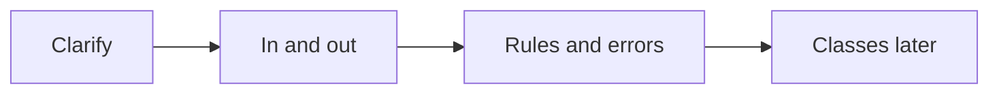

# Companion 2 — Requirements and Scope

**Canonical source:** [Mastery Lesson 2](../../../01-engineering-mastery/lld/module-05-lld/02-requirement-clarification-and-scope.md).

## Must remember

- Walk-in only. Cars and bikes now. Compatible spot. Nearest by configured priority. Ties arbitrary.
- Hourly by type, partial hours **round up**. Rate **captured at entry**.
- Session **only after** a successful claim. No spot → “No compatible spot available”, no session.
- Cash and card **methods**. No PSP in this scope.
- Payment failure: stay parked, **same fee**.
- Never two vehicles on one spot. Release after payment **or** entry rollback.

## Interview flow

## Scope

| In | Out |
| --- | --- |
| Entry, exit, hourly fee | Reservations, PSP SDKs |

## Explain aloud

1. “I will list rules before classes.”
2. “No spot means no session.”
3. “The entry rate sticks for that visit.”

## Practice

1. Which items are requirements versus design?
2. What happens on a declined card?
3. What happens if rates change at 18:00 for a car that entered at 09:00?
