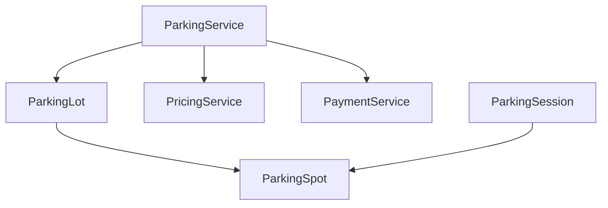

# Companion 3 — Domain Model

**Canonical source:** [Mastery Lesson 3](../../../01-engineering-mastery/lld/module-05-lld/03-domain-modeling-and-class-responsibilities.md).

## Must remember

- Types: `ParkingLot`, `ParkingSpot`, `Vehicle`, `ParkingSession`.
- No `ParkingFloor` until a floor has behavior. `floorNumber` sits on the spot.
- No extra allocation service. The lot orders candidates and retries claims.
- `ParkingService` orchestrates. It does not set occupancy.
- Session is the visit record. No ticket type yet.
- Cash/card stays in `PaymentService` until a provider exists.

## Explain aloud

1. “The spot owns occupied or free.”
2. “The lot picks the next candidate.”
3. “I omitted floor and ticket because they have no behavior yet.”

## Practice

1. Why not `ParkingFloor`?
2. What would make `ParkingLot` a god object?
3. When would you add a payment gateway?
