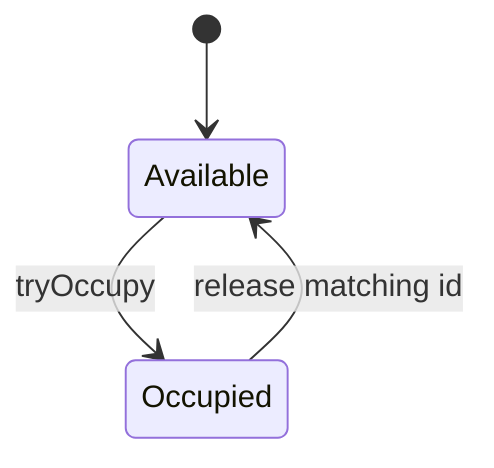
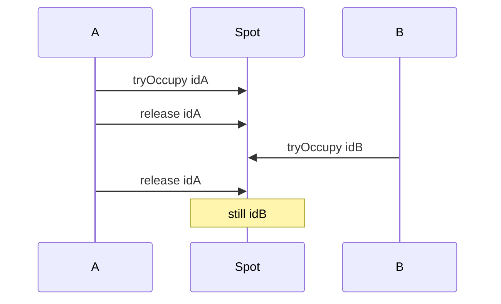

# Companion 4 — Encapsulation and Invariants

**Canonical source:** [Mastery Lesson 4](../../../01-engineering-mastery/lld/module-05-lld/04-encapsulation-invariants-and-tell-dont-ask.md).

## Must remember

- `tryOccupy()` → allocation id or empty. Id is **this claim**, not the vehicle for life.
- `isOccupied()` is a read. Do not claim with a setter.
- `release(id)` only if it is the current allocation.
- Session create fails → release **that** id.
- Payment fails → stay occupied, same fee.
- Stale cleanup from A must not free B.

## Explain aloud

1. “Tell the spot to occupy; don’t set flags.”
2. “Empty optional means try the next spot.”
3. “Release checks ownership so a late cleanup is harmless.”

## Practice

1. Why does check-then-set fail?
2. What do you do if the session insert fails?
3. Why is a declined card not a release?
