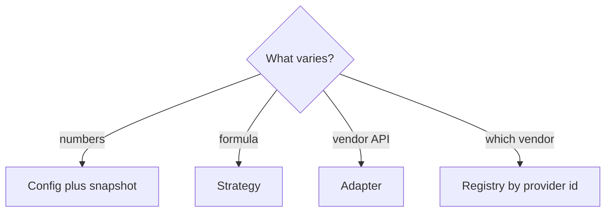

# Companion 5 — Abstraction and Patterns

**Canonical source:** [Mastery Lesson 5](../../../01-engineering-mastery/lld/module-05-lld/05-abstraction-composition-and-pattern-selection.md).

## Must remember

- **How** = algorithm. **What** = configuration. **When** = snapshot on the session.
- One formula for car, bike, and bus → rate config, not three strategies.
- Compose `ParkingLot`, `PricingService`, `PaymentService` as concrete collaborators until something must be swapped.
- No `Service` / `ServiceImpl` pair for a single class.
- Adapter at a **vendor** boundary. Registry key is **provider id**, not only “card”.
- Spring injects beans. It does not choose the route.
- No `CarSpot` subclass. `canFit` is data-driven behavior on one spot type.

## Decision table

| Problem | Approach |
| --- | --- |
| Split collaborators | Composition |
| Same math, different rates | Configuration |
| Remember entry rate | Snapshot |
| Incompatible provider API | Adapter |

## Explain aloud

1. “Three rates, one formula — a map, not three classes.”
2. “The session stores the rate from entry.”
3. “I add a gateway when a real provider appears, and I key it by provider id.”

## Practice

1. When is Strategy justified for pricing?
2. Why is CARD → provider ambiguous?
3. Why skip `PricingServiceImpl`?
